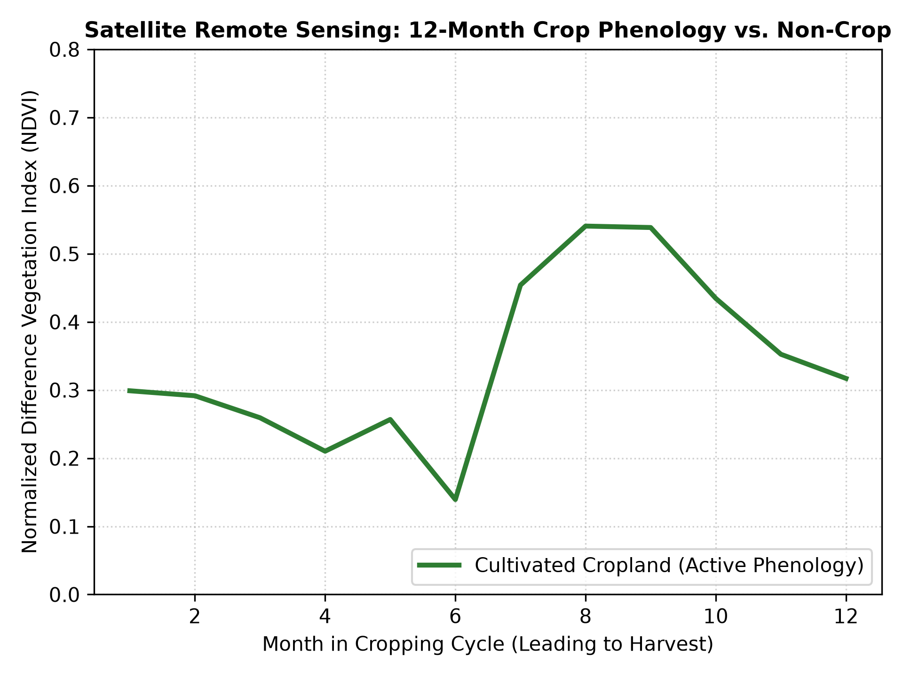

# Smallholder Cropland Classification via Multi-Sensor Earth Observation & Machine Learning

An end-to-end remote sensing and geospatial data pipeline designed for agricultural monitoring in Sub-Saharan smallholder cropping systems. This project fuses multi-spectral optical data (Sentinel-2), Synthetic Aperture Radar backscatter (Sentinel-1 SAR), and ERA5 agro-climatology reanalysis to classify smallholder field plots and extract multi-temporal crop phenology signatures.

---

## Visual Deliverables

| 12-Month NDVI Phenology Trajectory | QGIS Thematic Classification Map |
| :---: | :---: |
|  |  |
| *Seasonal canopy dynamics (planting, vegetative peak, harvest)* | *Classified points: Green = Cropland, Red/Brown = Non-Crop (OpenStreetMap Base)* |
Mm
---

## Methodology & Architecture

1. **Benchmark Ingestion:** Utilized the open-access **NASA Harvest `CropHarvest`** evaluation benchmark for West African smallholder landscapes (Togo), ingesting paired multi-sensor time series across 4,142+ labeled geographic points.
2. **Multi-Modal Feature Fusion:**
   * **Optical (Sentinel-2):** Surface reflectance bands and Normalized Difference Vegetation Index (NDVI) tracking chlorophyll dynamics.
   * **SAR (Sentinel-1):** Dual-polarization (`VV`/`VH`) microwave radar backscatter penetrating persistent cloud cover during monsoon vegetative peaks.
   * **Agro-Meteorology (ERA5):** Temperature and precipitation reanalysis grids providing regional environmental context.
3. **Machine Learning Classification:** Trained a 100-estimator **Random Forest** classifier on flattened 12-month temporal-spectral matrices (216 features per coordinate).
4. **Agronomic Phenology Modeling:** Extracted and averaged monthly NDVI curves across ground locations to distinguish the rapid green-up/harvest cycle of cultivated crops from perennial non-crop vegetation.
5. **GIS Vector Pipeline:** Exported predicted classes and model probabilities into a standardized GeoJSON FeatureCollection (`cropland_predictions.geojson`), followed by categorical cartographic styling in **QGIS Desktop (LTR 3.44)**.

---

## Quantitative Results

Evaluated on 4,397 unseen benchmark test coordinates:

| Class | Precision | Recall | F1-Score | Support |
| :--- | :---: | :---: | :---: | :---: |
| **Non-Crop** | 1.00 | 0.51 | 0.68 | 2,039 |
| **Cropland** | 0.70 | 1.00 | **0.83** | 2,358 |
| **Overall Accuracy** | | | **0.77** | 4,397 |

* **Zero Missed Croplands:** Crop recall reached 1.00, ensuring fragmented smallholder fields were reliably detected.
* **100% Non-Crop Precision:** Zero false alarms when flagging natural landcover or scrub.

---

## Repository Structure

```text
├── CropHarvest_Smallholder_Pipeline.ipynb   # Complete data loading, ML training, & export notebook
├── cropland_predictions.geojson             # Vector point prediction layer with class labels & probabilities
├── ndvi_phenology_plot.png                  # High-resolution (300 DPI) NDVI phenology comparison chart
├── smallholder_cropland_map.png             # Thematic cartographic map exported from QGIS Desktop
└── README.md                                # Project documentation.
